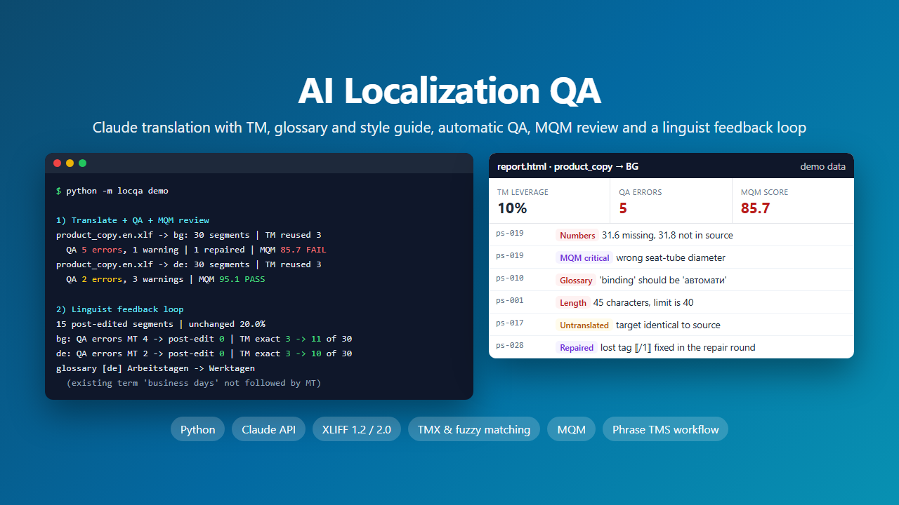
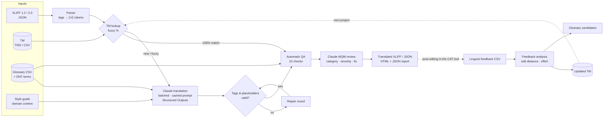
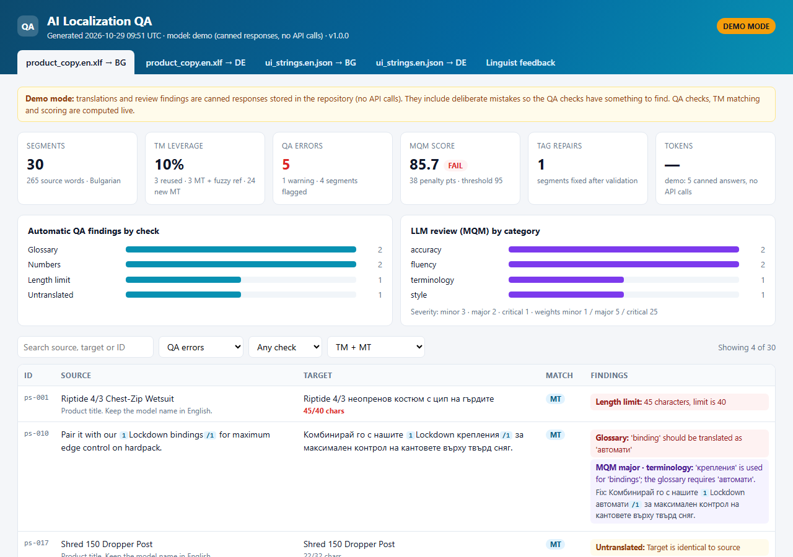
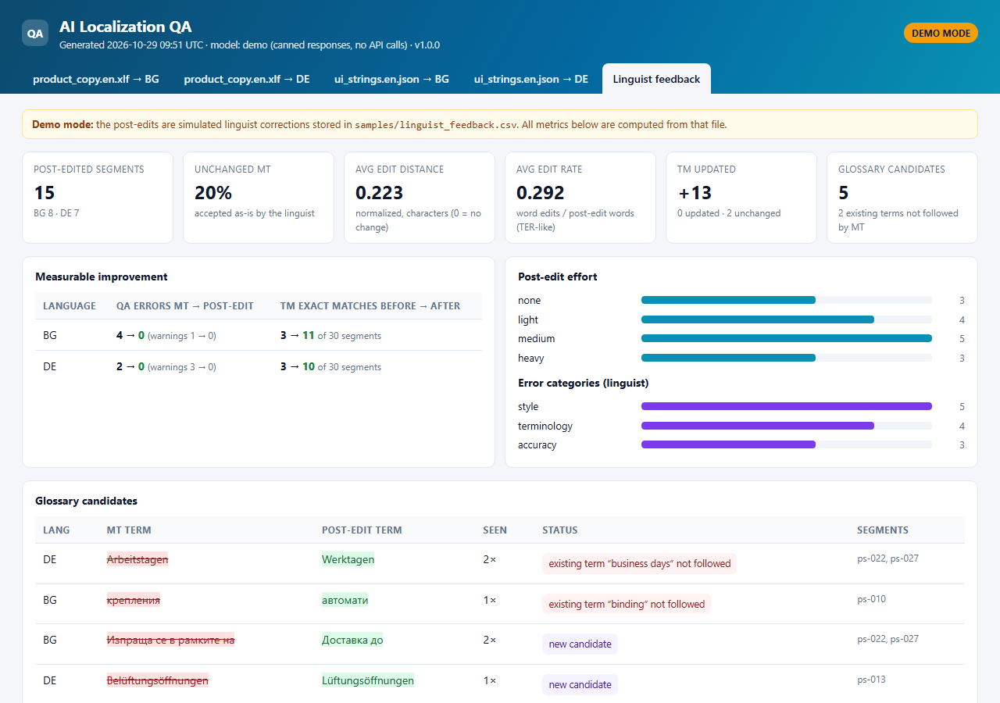

# AI Localization QA

An AI translation and quality-assurance pipeline for localization projects. It translates XLIFF and JSON files with Claude, using a **translation memory**, a **glossary** and a **style guide**, then checks the result with **automatic QA checks** and an **MQM-style LLM review**. A **linguist feedback loop** turns post-edits into metrics, TM updates and glossary candidates.

The sample project is action-sports e-commerce copy (surf, snowboard, MTB) from English into **Bulgarian** and **German**.



## The problem

Raw LLM translation is fluent, but a localization agency can't deliver it as it is:

- **Tags and placeholders break.** A dropped `</g>` or a translated `{count}` breaks the file in the CAT tool or the shop.
- **Terminology drifts.** "Bindings" must be *автомати* in Bulgarian and *Bindung* in German every time, and product names must stay in English.
- **Earlier work is ignored.** Approved translations in the TM should be reused, not translated again in different words.
- **Quality is hard to measure.** PMs need numbers (errors, scores, post-edit effort) to decide what goes to review and whether the tool is getting better.
- **Linguist corrections get lost.** The same mistakes come back in the next project.

This tool deals with each of these points and reports on them.

## What it does

| Step | What happens |
|---|---|
| **1. Parse** | Reads **XLIFF 1.2** (incl. Phrase `.mxliff`), **XLIFF 2.0** and **JSON** resource files. Inline tags (`<g>`, `<x/>`, `<ph>`, `<pc>`, ...) are replaced by tokens such as `⟦1⟧...⟦/1⟧` and put back byte for byte when the file is written. Notes, length limits (`maxwidth`, `slr:sizeRestriction`) and locked units are respected. |
| **2. TM lookup** | Fuzzy matching against a **TMX or CSV** TM, written from scratch (word-level Levenshtein + character similarity, reported as a match %). 100% matches are reused without the LLM, and matches of 75% or more are sent to Claude as reference. |
| **3. Translate** | Claude translates in **batches** (15 segments per request), with the glossary, style guide and domain context in a **prompt-cached** system prompt. Each batch only carries the segments, their glossary hits and TM matches. Answers use **Structured Outputs**. |
| **4. Validate & repair** | Every tag token and placeholder must come back unchanged. Segments that fail are sent back once with the problem described (a **repair round**). |
| **5. Automatic QA** | Deterministic checks (no LLM): tags/placeholders, numbers, units, punctuation, whitespace, length limits, glossary, do-not-translate terms, untranslated segments, inconsistent translations. |
| **6. MQM review** | Claude reviews every segment with an MQM-style typology (category, severity, explanation, suggested fix) via Structured Outputs. A score per file decides pass/fail. |
| **7. Write** | Translated XLIFF/JSON. Segments with QA errors get the XLIFF state `needs-review-translation`, so they stand out in the CAT tool. |
| **8. Report** | A standalone **HTML report** (summary metrics, per-segment findings, filters) and a **JSON report** for dashboards or CI. |
| **9. Feedback loop** | Reads linguist post-edits (source / MT / post-edit), computes **edit distance and post-edit effort**, adds the confirmed translations to the **TM**, and lists **glossary candidates**. It also shows when the MT ignored a term that was already in the glossary. |

## Architecture



## Quickstart

Python 3.10+.

```bash
pip install -r requirements.txt
```

### Demo (no API key needed)

```bash
python -m locqa demo
```

This runs the full workflow on the sample files in `samples/` and writes everything to `outputs/demo/`. Open `outputs/demo/report.html` in a browser.

> **Demo mode is clearly labelled.** Claude's translations and review findings are replaced by canned responses stored in `demo/canned/`, written by hand for the sample files, with deliberate mistakes so that the checks have something to find. Everything else runs for real: parsing, TM matching, batching and prompt building, validation and the repair round, the QA checks, MQM scoring, the feedback analysis and the reports. A copy of the demo output is in [`examples/demo-output/`](examples/demo-output/).

### With the Claude API

```bash
cp .env.example .env      # Windows: copy .env.example .env
# add your API key from https://console.anthropic.com to .env

python -m locqa translate samples/product_copy.en.xlf samples/ui_strings.en.json \
    -t bg de \
    --glossary samples/glossary.csv --tm samples/tm.tmx \
    --style-guide samples/style_guide.md --context samples/domain_context.md \
    --out outputs/run1
```

Other commands:

```bash
# QA of a file that is already translated (e.g. exported from Phrase after human translation), no LLM needed
python -m locqa qa outputs/run1/product_copy.de.xlf --glossary samples/glossary.csv
python -m locqa qa samples/ui_strings.en.json --target outputs/run1/ui_strings.de.json -t de --glossary samples/glossary.csv

# Linguist feedback: metrics, TM update, glossary candidates, TM leverage before/after
python -m locqa feedback samples/linguist_feedback.csv --tm samples/tm.tmx --glossary samples/glossary.csv \
    --source-file samples/product_copy.en.xlf
```

Useful options: `--batch-size`, `--fuzzy-min`, `--mqm-threshold`, `--effort`, `--no-review`, and `--fail-on-errors` (exit code 2 on QA errors or a failed MQM score, for use in CI).

## Demo output

This is the actual output of `python -m locqa demo` (demo mode, canned LLM responses):

```text
1) Translate + QA + MQM review
  product_copy.en.xlf -> bg: 30 segments | TM reused 3, MT 27 (3 with fuzzy ref) | QA 5 errors, 1 warning | 1 repaired | MQM 85.7 FAIL
  product_copy.en.xlf -> de: 30 segments | TM reused 3, MT 27 (3 with fuzzy ref) | QA 2 errors, 3 warnings | MQM 95.1 PASS
  ui_strings.en.json -> bg: 9 segments | TM reused 0, MT 9 (0 with fuzzy ref) | QA 0 errors, 0 warnings | MQM 100.0 PASS
  ui_strings.en.json -> de: 9 segments | TM reused 0, MT 9 (0 with fuzzy ref) | QA 0 errors, 0 warnings | 1 repaired | MQM 100.0 PASS
   14 requests answered by the demo client

2) Linguist feedback loop
  15 post-edited segments | unchanged 20.0% | avg edit distance 0.223 | avg edit rate 0.292
  bg: 8 segments, effort {'none': 1, 'light': 2, 'medium': 2, 'heavy': 3} | QA errors MT 4 -> post-edit 0 | TM exact matches 3 -> 11 of 30
  de: 7 segments, effort {'none': 2, 'light': 2, 'medium': 3, 'heavy': 0} | QA errors MT 2 -> post-edit 0 | TM exact matches 3 -> 10 of 30
  TM: +13 added, 0 updated -> outputs/demo/tm_updated.tmx
  glossary [de] 'Arbeitstagen' -> 'Werktagen' (2x, existing term 'business days' not followed by MT)
  glossary [bg] 'крепления' -> 'автомати' (1x, existing term 'binding' not followed by MT)
  glossary [bg] 'Изпраща се в рамките на' -> 'Доставка до' (2x, new candidate)
  glossary [de] 'Belüftungsöffnungen' -> 'Lüftungsöffnungen' (1x, new candidate)
  glossary [de] 'Lieferung' -> 'Versand' (1x, new candidate)
```

What the checks found in the Bulgarian file (from the canned MT):

| Segment | Finding | Source |
|---|---|---|
| ps-019 | `31.6` missing, `31,8` not in source (wrong seat-tube diameter) | Numbers check + MQM *critical* |
| ps-010 | "bindings" translated as *крепления*, glossary says *автомати* | Glossary check + MQM *major* |
| ps-017 | Product type left in English | Untranslated + glossary checks + MQM *major* |
| ps-001 | 45 characters, limit is 40 | Length check |
| ps-028 | The first answer dropped the closing tag `⟦/1⟧` | Fixed automatically in the repair round |

In German, the QA checks caught *Arbeitstagen* instead of the glossary term *Werktagen* and the same sentence translated two different ways (ps-022 / ps-027). The feedback analysis then showed that this term was already in the glossary, so the fix is to enforce the glossary harder, not to add a new term.

**The HTML report**, per file and language, with filters by severity, check and TM/MT origin:



**The feedback tab**: post-edit effort, QA errors before and after post-editing, TM leverage before and after the TM update, and glossary candidates:



## How it fits a Phrase TMS workflow

The tool is designed around the files a Phrase TMS project produces. It works on exported files and has not been tested against a live Phrase account.

| Phrase TMS step | This tool |
|---|---|
| Export the job as bilingual **XLIFF 1.2 / MXLIFF** (or XLIFF 2.0) | `translate` reads it directly. Locked units (`m:locked="true"`) and `translate="no"` are skipped, and everything else in the file is kept unchanged. |
| Export the **TM as TMX** and the **term base as CSV** | `--tm` and `--glossary`. Term base columns: `term`, one column per language, `do_not_translate`, `note`. |
| Pre-translate with TM, then MT | 100% matches are reused, fuzzy matches go to Claude as reference, the rest is translated with Claude. |
| Run QA before delivery | 10 automatic checks, similar to Phrase QA / Xbench, plus the MQM review. |
| Import the translated XLIFF back | Segment states are set: `translated`, or `needs-review-translation` where QA found errors, so linguists can filter on them. |
| Linguists post-edit in the Phrase editor | Export source / MT / post-edit (for example from the post-editing analysis or an LQA sheet) to CSV. |
| Feed the corrections back | `feedback` writes an updated TMX to import, a glossary candidates CSV for the terminologist, and the metrics PMs need. |

`qa` also works on its own, for human or vendor translations exported from Phrase.

## Design notes

**Prompting.** The system prompt holds the rules (tags, placeholders, glossary, TM use, length limits, number formats, tone), the domain context, the style guide and the full glossary for the target language. It is identical for every batch of a language and marked with `cache_control`, so batches after the first read it from the prompt cache. The user message is JSON with the segments, the glossary terms found in each segment, TM matches with their scores, context notes and `max_chars`.

**Reliable output.** Both the translation and the review use Structured Outputs (`output_config.format` with a JSON schema), so answers always parse. The MQM categories and severities are enums in the schema. The code checks `stop_reason` for refusals and cut-off answers and shows a clear error. With the default model it uses the server-side fallback beta, the same pattern as my other Claude projects.

**Model.** `claude-opus-5-5` by default, or set `CLAUDE_MODEL`. `--effort` (default `medium`) trades quality for cost.

**Tags.** Inline elements become `⟦n⟧` tokens, so the model never sees raw XML and can't break it. The original markup is stored per segment and put back on write. A target with broken tags is never written as invalid XML: it stays empty with state `needs-translation` and is listed in the console output.

## QA checks

| Check | What it catches | Severity |
|---|---|---|
| Tags & placeholders | Missing, extra or renamed `⟦n⟧` tags, `{count}`, `{{name}}`, `%s`, `%1$s`, `${var}`, HTML tags. Paired tags in the wrong order. | error |
| Numbers | Numbers missing or changed. `20,000` / `20.000` / `20 000` and `4.5` / `4,5` count as equal. | error |
| Units | A unit missing after a number. Cyrillic symbols are accepted (`mm`/`мм`, `kg`/`кг`, `g`/`г`, `h`/`ч`). | error |
| Length limit | Visible characters above `maxwidth` / `sizeRestriction` (tags not counted). | error |
| Glossary | An approved term not used. Inflected forms count (*неопреновият костюм*, *Werktagen*), and irregular forms are listed as variants (*Naht\|Nähte*). | error |
| Do-not-translate | Brand and product names changed (*Riptide*, *MIPS*, *Fidlock*). | error |
| Untranslated | Empty target (error), or target identical to source (warning). Not flagged when it only contains DNT names, codes such as XS/XXL, and terms that stay the same (*Snowboard* in German). | error / warning |
| Punctuation | Different ending punctuation, unbalanced brackets. | warning |
| Whitespace | Leading/trailing spaces, double spaces, a space before punctuation. | warning |
| Consistency | The same source translated in different ways in one file. | warning |

## MQM scoring

Review findings get penalty points by severity: **minor 1, major 5, critical 25**. The score is normalized by the source word count, as in the MQM scoring model:

```
score = 100 × (1 − penalty points / source words)
```

A file passes at 95 or above (`--mqm-threshold`). In the demo, the Bulgarian file has 38 penalty points over 265 words (85.7, fail, with one critical number error). The German file has 13 points (95.1, pass).

## Feedback metrics

| Metric | Meaning |
|---|---|
| Normalized edit distance | Character Levenshtein distance MT → post-edit, divided by the longer length (0 = unchanged) |
| Edit rate | Word edits divided by post-edit words (like TER, without shifts) |
| Effort | none (0), light (≤ 0.15), medium (≤ 0.40), heavy (> 0.40) |
| QA before/after | Automatic QA errors on the MT and on the post-edit |
| TM leverage before/after | Exact TM matches on a source file before and after the TM update |
| Glossary candidates | MT → post-edit substitutions that repeat or were marked as terminology, labelled *new candidate* or *existing term not followed by MT* |

## Tests

```bash
python -m unittest discover tests
```

**66 tests**, offline, using only the standard library `unittest` (no network, no API key). They run in under a second.

- **Parsers:** XLIFF 1.2 and 2.0 round trips with byte-exact inline tags (`<g>`, `<x/>`, `<ph>`, nested `<pc>`, `originalData`), token numbers shared between source and target, escaping, segment states, locked units, broken tags never written as invalid XML, nested JSON, clear errors for bad files
- **TM & fuzzy matching:** Levenshtein, scores for exact, whitespace-only and one-word differences, language variants (`de` = `de-DE`), TMX with native code, CSV TM, add/update and TMX round trip
- **Glossary:** plurals, word boundaries, case-sensitive DNT terms, Bulgarian and German inflection, variants
- **Every QA check**, with passing and failing examples
- **MQM scoring:** weights, normalization, threshold, floor at 0
- **Feedback:** metrics, effort buckets, substitutions, glossary candidate statuses, TM update and leverage, QA before/after
- **Claude integration with a fake client:** batching, a byte-identical cached system prompt across batches, `cache_control`, Structured Outputs schema, fallback parameters, TM matches and glossary hits in the payload, the repair round, missing segments, refusal and `max_tokens` handling, review parsing
- **End to end:** the full `demo` command, with checks on every output file, the report numbers, and tags/placeholders preserved in the translated files

## Project structure

```
7-ai-localization-qa/
├── locqa/
│   ├── cli.py           # argparse CLI: translate, qa, feedback, demo
│   ├── pipeline.py      # TM lookup -> translation -> QA -> review -> write
│   ├── xliff.py         # XLIFF 1.2 / 2.0 reader and writer, tag masking
│   ├── jsonres.py       # JSON resource files
│   ├── formats.py       # file type detection, output names
│   ├── tags.py          # ⟦n⟧ tokens, placeholders, tag order
│   ├── fuzzy.py         # fuzzy match scoring (from scratch)
│   ├── tm.py            # translation memory (TMX / CSV)
│   ├── glossary.py      # term base with DNT terms and inflection-aware matching
│   ├── qa_checks.py     # deterministic QA checks
│   ├── llm.py           # Claude: batching, prompt caching, Structured Outputs, repair round, MQM review
│   ├── mqm.py           # MQM categories, severities, scoring
│   ├── feedback.py      # post-edit metrics, TM update, glossary candidates
│   ├── report.py        # JSON + HTML report
│   ├── demo.py          # offline demo client (canned responses)
│   └── templates/report.html
├── samples/             # EN source XLIFF 1.2 (30 segments), XLIFF 2.0, JSON, glossary, TMX, style guide, feedback CSV
├── demo/canned/         # canned translations and review findings for demo mode (bg, de)
├── examples/            # cover, screenshots, demo-output/
├── tests/               # 66 unittest tests
├── requirements.txt
└── .env.example
```

## Limitations and roadmap

- **Not yet run against the real API.** All numbers above come from demo mode, where Claude's answers are canned. The API code follows the same pattern as my other Claude projects and is tested with a fake client, but translation quality, token usage and cost with real output still need to be measured on a real project.
- **Glossary matching is heuristic.** Inflection is handled with a simple prefix rule and a variants list, not a morphological analyser.
- **TM.** Matching is brute force, which is fine for thousands of units but not for millions (an n-gram index would fix that). TMX inline codes are left out of the match text.
- **XLIFF.** Segmented `<seg-source>`/`<mrk mtype="seg">` sources are not split; the whole `<source>` is one segment.
- **Roadmap:**
  - Phrase TMS REST API integration, to pull jobs and push translations without manual export/import
  - Message Batches API for large overnight jobs (50% cheaper)
  - TBX term base import and ICU plural-aware placeholder checks
  - A small web UI for PMs
  - Tracking metrics across projects, to show improvement over time
